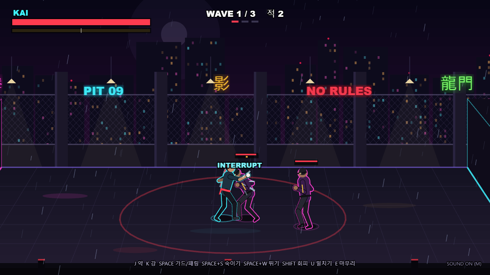
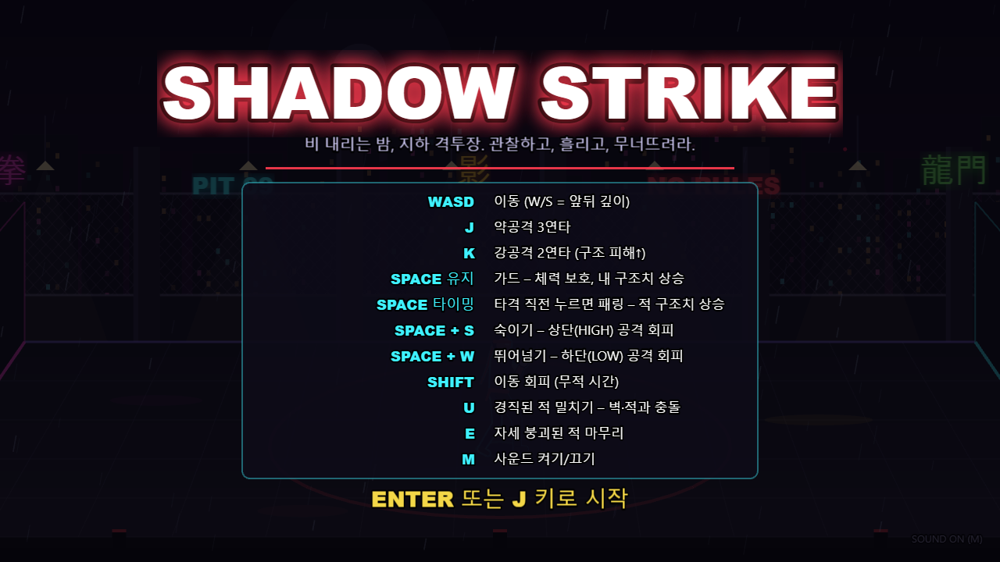

<div align="center">

# SHADOW STRIKE

**비 내리는 지하 격투장, 단 한 명으로 끝까지 살아남아라.**

타이밍에 맞춘 패링과 회피, 연속 공격, 자세 붕괴와 마무리 기술이 핵심인 **2.5D 브라우저 격투 액션 게임**.

[**▶ 브라우저에서 플레이**](https://legerdo.github.io/shadow-strike/) · [조작법](#-조작법) · [로컬 실행](#-로컬-실행)


[](https://github.com/Legerdo/shadow-strike/actions/workflows/deploy-pages.yml)

<a href="https://legerdo.github.io/shadow-strike/">
  
</a>

*클릭하여 바로 플레이*

</div>

## 게임 소개

**SHADOW STRIKE**는 한정된 공간에서 여러 적을 상대하는 싱글플레이어 액션 게임입니다. 상대의 공격을 관찰하고, 타이밍에 맞춰 방어하거나 피한 뒤 반격하세요. **총 3개의 웨이브**를 돌파하면 승리합니다.

- **타격과 콤보** — 약공격 3연타와 강공격 2연타, 입력 버퍼를 통한 콤보 연결
- **가드와 패링** — 공격을 막거나 적중 직전에 패링하여 반격 기회 확보
- **상·하단 회피** — 상단 공격은 숙이고, 하단 공격은 뛰어넘는 대응
- **자세 붕괴와 마무리** — 상대의 구조치를 누적해 빈틈을 만들고 결정타 실행
- **지형 활용** — 경직된 적을 밀쳐 벽이나 다른 적에게 충돌시키기
- **세 가지 적 유형** — THUG, VIPER, BRUTE가 등장하는 단계별 전투
- **전투 연출** — 비 내리는 네온 아레나, 타격 이펙트, 카메라 흔들림과 효과음

## 스크린샷

### 타이틀 및 조작 안내



### 전투 플레이


> 실제 브라우저 게임을 실행하여 촬영한 스크린샷입니다.

## 조작법

| 키 | 기능 |
| :--- | :--- |
| `W A S D` 또는 방향키 | 이동 (W/S는 화면 안쪽·바깥쪽으로 이동) |
| `J` | 약공격 / 3연타 콤보 |
| `K` | 강공격 / 2연타 콤보 |
| `Space` 유지 | 가드 |
| 타격 직전 `Space` | 패링 |
| `Space + S` | 숙여서 상단 공격 회피 |
| `Space + W` | 뛰어넘어 하단 공격 회피 |
| `Shift` | 무적 구간이 있는 회피 이동 |
| `U` | 경직된 적 밀치기 |
| `E` | 자세가 붕괴된 적 마무리 |
| `M` | 사운드 켜기/끄기 |
| `Enter` | 타이틀 화면에서 시작 |
| `R` | 재시작 |

> 키보드 조작과 WebGL을 지원하는 데스크톱 브라우저를 권장합니다. 처음에는 가드와 패링의 타이밍을 익히고, 적의 공격 높이 경고를 확인하세요.

## 로컬 실행

**준비물:** Node.js 24 이상과 npm, Chrome 또는 Edge 등 WebGL 지원 브라우저

### Windows

저장소를 내려받은 뒤 **`run-game.bat`를 더블클릭**하세요. 필요한 의존성을 설치하고 로컬 서버를 시작한 다음 기본 브라우저로 게임을 엽니다.

### 터미널

```bash
git clone https://github.com/Legerdo/shadow-strike.git
cd shadow-strike
npm ci
npm run dev
```

기본 주소: **http://localhost:5173/**

| 명령 | 설명 |
| :--- | :--- |
| `npm run dev` | 개발 서버 실행 |
| `npm run build` | TypeScript 검사 후 정적 사이트 빌드 (`dist/`) |
| `npm run preview` | 빌드 결과 로컬 확인 |
| `npm test` | Vitest 게임 로직 테스트 |
| `npm run smoke` | 실행 중인 개발 서버를 대상으로 브라우저 테스트 |
| `npm run screenshots` | 실행 중인 개발 서버에서 README 스크린샷 재촬영 |

`smoke`와 `screenshots`는 Chrome 또는 Edge가 설치되어 있어야 합니다. 각각 별도 터미널에서 `npm run dev`를 실행한 뒤 사용하세요.

## 프로젝트 구조

```text
src/
  anim/          애니메이션 상태와 포즈
  audio/         효과음
  game/          전투, 물리, AI, 웨이브 등 게임 규칙
  input/         키보드 입력 및 액션 매핑
  render/        캐릭터, 경기장, 이펙트 렌더링
  scenes/        Phaser 게임 씬
  ui/            HUD 및 타이틀·결과 화면
tests/           게임 로직 테스트
scripts/         브라우저 스모크 테스트 및 스크린샷
docs/screenshots/ README에 사용되는 실제 게임 화면
.github/workflows/ GitHub Pages 자동 배포
run-game.bat     Windows 원클릭 실행
```

게임 규칙은 렌더링과 분리된 `GameWorld`에서 **고정 시간 간격**으로 처리합니다. Phaser 3가 WebGL 렌더링과 연출을, TypeScript가 게임 로직을, Vite가 개발 서버 및 정적 빌드를 담당합니다.

## GitHub Pages 배포

**[SHADOW STRIKE 플레이하기 →](https://legerdo.github.io/shadow-strike/)**

`main` 브랜치에 푸시하면 [GitHub Actions](https://github.com/Legerdo/shadow-strike/actions/workflows/deploy-pages.yml)가 의존성 설치, 빌드, 테스트를 수행한 다음 `dist/`를 GitHub Pages로 배포합니다. Actions 탭에서 수동으로 재배포할 수도 있습니다.
